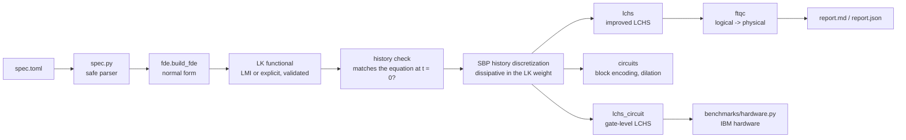

# qfde architecture

qfde is a compiler. It takes a linear delay or integro-differential equation and produces one quantum algorithm (LK-weighted spectral discretization + LCHS) with a proof of dissipativity and its cost. Each layer has one job and a test that checks it.

| Layer | Module | Guarantee | Tested by |
|---|---|---|---|
| Spec | `spec.py` | Only whitelisted arithmetic is evaluated (AST check) | `test_spec_*` |
| Normal form | `fde.py` | Exact rewrite of every supported class | manufactured solutions, references |
| LK functional | `fde.certify`, `verify.py` | LMI feasible ⇒ main theorem; validated for all t | property-based random systems |
| Discretization | `fde.make_generator`, `weight_general` | sym(W G) ⪯ 0 for every p and mesh | `test_main_theorem_*` |
| History check | `compiler.history_jump` | Detects a history that does not match the equation at t = 0 | `test_compiler_detects_mismatched_history` |
| Algorithm | `lchs.py` | LCHS emulation reproduces exp(Ĝ T) | `test_lchs_*` |
| Circuits | `circuits.py`, `lchs_circuit.py` | Block equals Ĝ/α to 1e-14; dilation is unitary; LCHS circuit equals the LCU sum to 1e-10 and converges to the solution | `test_sparse_block_*`, `test_dilation_*`, `test_lchs_circuit_*` |
| Costs | `ftqc.py`, `resources.py` (prior methods) | Qualtran primitives → Microsoft estimator | `test_ftqc_*` |
| Interface | `compiler.py`, `cli.py` | Every decision is recorded in the report | `test_compiler_*` |
